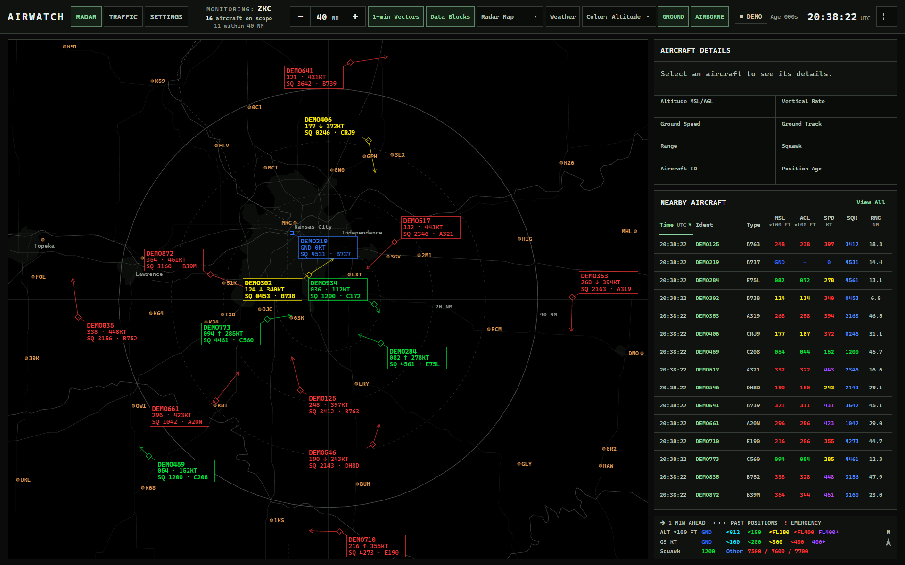

# Airwatch

Airwatch is a touchscreen flight-tracking kiosk for plane spotting. It runs locally on Windows or a Raspberry Pi and shows nearby aircraft on a radar-style scope. Get started with offline Demo traffic, or choose a live ADS-B feed in Settings.

[Illustrated user manual (PDF)](docs/Airwatch-User-Manual.pdf) · [Installation, configuration, and troubleshooting](docs/configuration.md) · [Agent setup guide](AGENTS.md)



*Radar screen in Demo mode. Aircraft shown are simulated.*

## What you can do

- Switch between **Radar**, **Traffic**, and **Settings** with the header tabs, a horizontal swipe, or the arrow keys.
- Tap an aircraft for details, sort the live traffic table, and use the 1-minute vectors and position history to see how aircraft are moving.
- Monitor custom coordinates or choose a U.S. airspace preset. Set the range ring from 1 to 100 nautical miles and color targets by altitude, speed, or squawk.
- Use the offline **Radar Map**, or connect to the internet for USGS imagery, FAA VFR and IFR charts, and the U.S. NEXRAD weather mosaic.
- Run offline in **Demo**, use an internet ADS-B provider, or connect a local readsb-compatible receiver.

## Run on Windows

Install Node.js 20 or newer, open PowerShell in the project folder, and run the following. Airwatch has no npm dependencies to install. [Download Node.js](https://nodejs.org/en/download)

```powershell
node --version
node server.mjs
```

Open [http://127.0.0.1:8080/](http://127.0.0.1:8080/) in Chrome or Edge. A fresh browser profile opens **Radar** in **Demo** at Kansas City with a 40 NM ring. To use the keyless adsb.fi feed for personal, noncommercial viewing, open **Settings**, select **adsb.fi** under **Source**, and tap **Save settings**. Press **F11** for fullscreen or **Ctrl+C** in PowerShell to stop the server.

## Run as a Raspberry Pi kiosk

The kiosk hardware is a **Raspberry Pi 5** with a **CX101PI-C 10.1-inch 1920 × 1200 touchscreen monitor** and integrated Pi case. The [Pi setup guide](docs/configuration.md#raspberry-pi-kiosk-setup) covers Raspberry Pi OS Desktop, Wi-Fi, automatic Chromium launch, and the built-in numeric keypad. The kiosk keeps its settings in a dedicated browser profile.

Airwatch is for hobby plane spotting. Aircraft and weather coverage depend on their sources. See the [data sources and credits](docs/configuration.md#data-sources-and-credits) for coverage, attribution, and provider terms.

## License

The original Airwatch code is available under the [Zero-Clause BSD license (0BSD)](LICENSE). You can use, modify, and redistribute it for any purpose, including commercial use, with no attribution requirement.

Third-party components and bundled datasets retain their own terms. Live traffic feeds and online map layers are subject to their providers’ terms. [Data sources and credits](docs/configuration.md#data-sources-and-credits) · [Leaflet license](public/vendor/leaflet/LICENSE)
